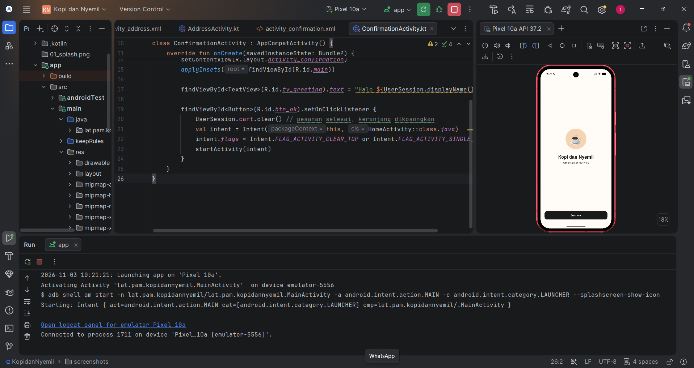
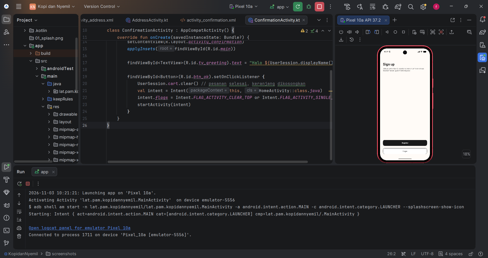
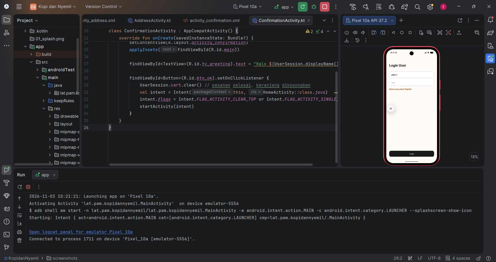
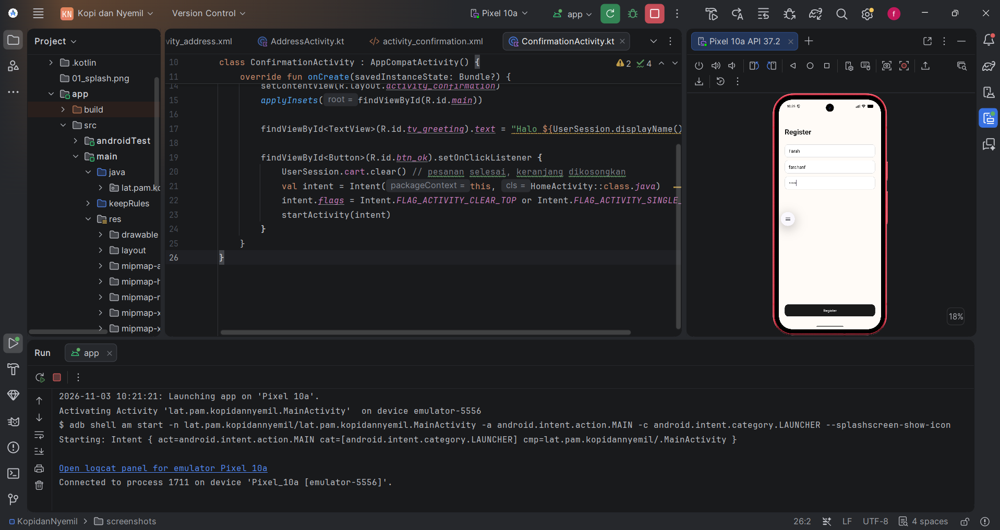
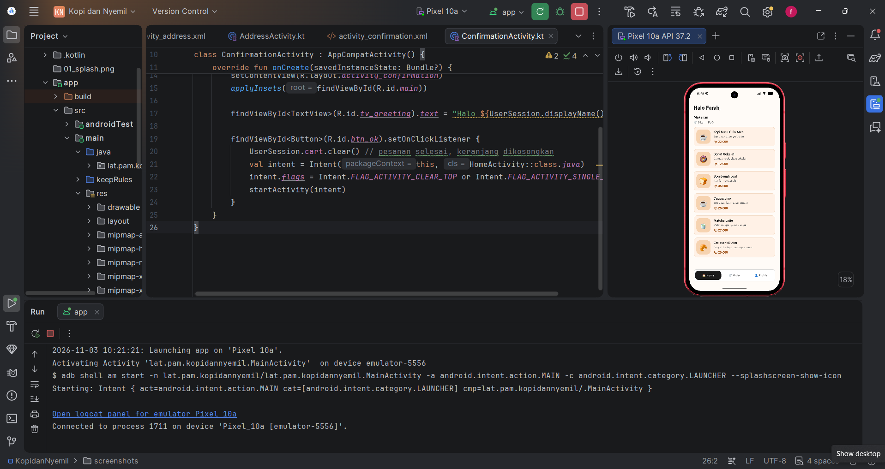
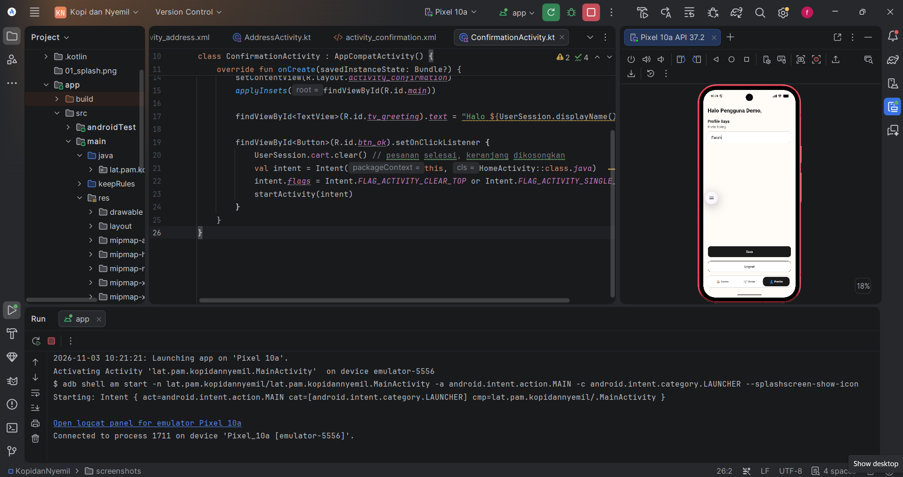
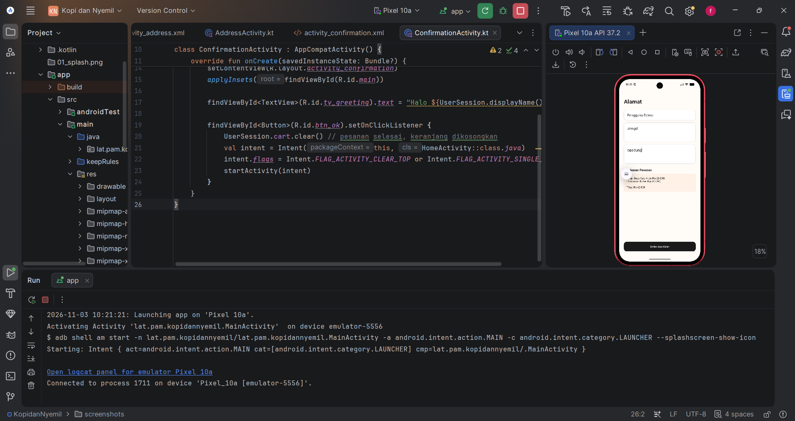
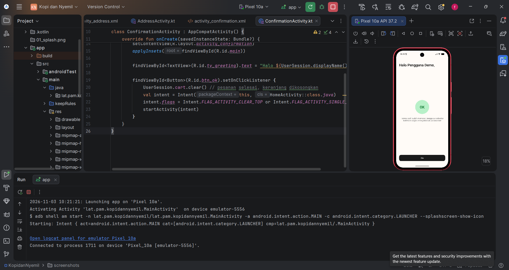

# Kopi dan Nyemil

Aplikasi mobile Android untuk memesan kopi dan makanan ringan, dibuat berdasarkan wireframe "Kopi dan Nyemil" untuk tugas mata kuliah Pemrograman Aplikasi Mobile.

## Fitur
- Splash / Welcome screen
- Sign up, Login, dan Register (data user disimpan sementara di memori)
- Home: daftar 6 menu makanan dan minuman (data dummy)
- Klik menu untuk menambahkan ke pesanan, lengkap dengan total harga
- Profile: ubah nama dan logout
- Alamat pengiriman beserta ringkasan pesanan
- Konfirmasi pesanan
- Bottom navigation (Home, Order, Profile)

## Teknologi
- Bahasa: Kotlin
- UI: XML Layout (Views), Material Components, RecyclerView
- IDE: Android Studio
- Minimum SDK: API 27 (Android 8.1)
- Tanpa database (menggunakan data statis / dummy)

## Cara Menjalankan
1. Clone repository ini:
   ```
   git clone https://github.com/farahnoidd/KopiDanNyemil.git
   ```
2. Buka folder project di Android Studio, lalu tunggu Gradle sync selesai.
3. Jalankan di emulator atau perangkat Android dengan tombol **Run 'app'**.
4. Login dengan akun demo: **username `admin`**, **password `12345`**, atau daftar akun baru lewat menu Register.

## Alur Aplikasi
Splash → Sign up → Login / Register → Home ⇄ Profile → Alamat (Order) → Konfirmasi → Home

## Screenshot
| Splash | Sign up | Login | Register |
|---|---|---|---|
|  |  |  |  |

| Home | Profile | Alamat | Konfirmasi |
|---|---|---|---|
|  |  |  |  |

## Pembuat
Farah Annafia, Teknik Informatika, UIN Sunan Gunung Djati Bandung